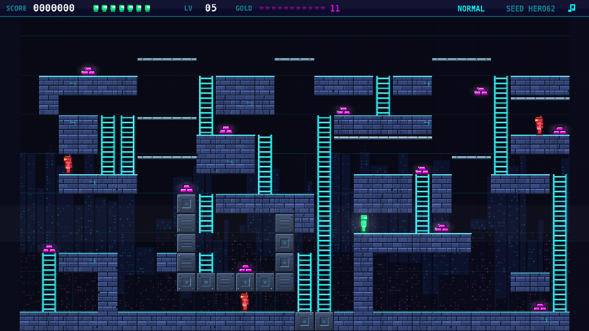
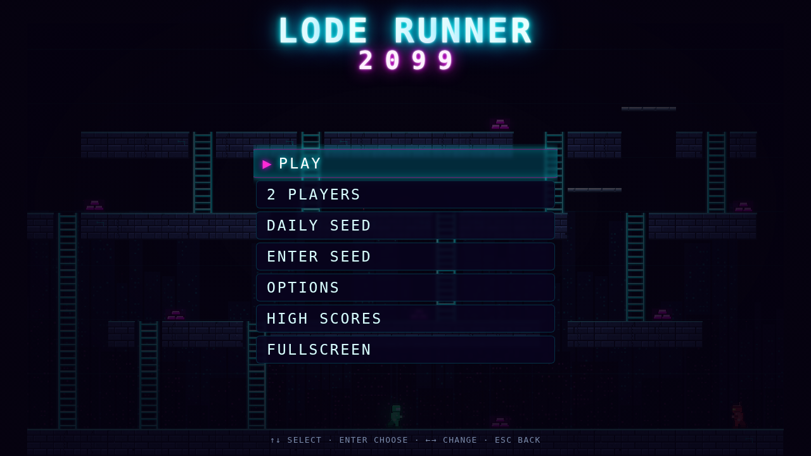
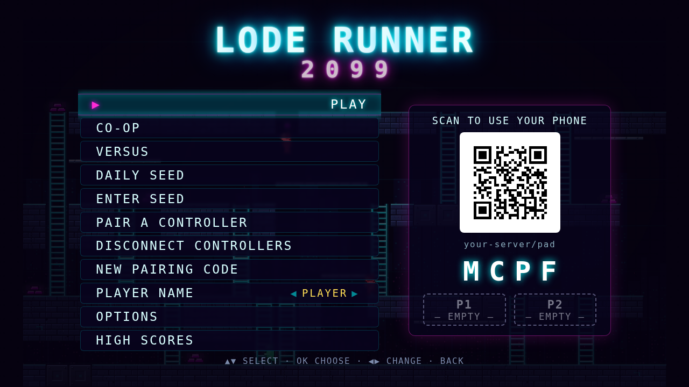
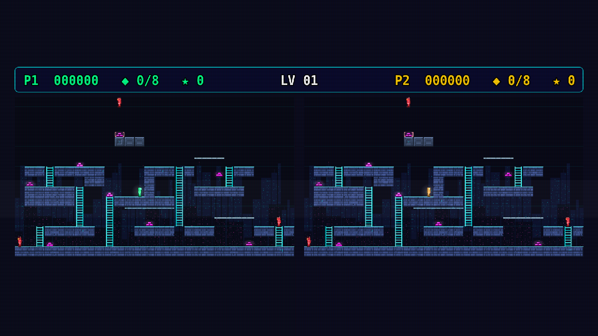

# Lode Runner 2099

[](https://loderunner2099.exe.xyz/)
[](LICENSE)

A neon reimagining of classic Lode Runner: endless procedurally generated (and provably solvable) levels, adaptive
procedural chiptune music, 2-player co-op and split-screen versus, a TV mode with your phone as the controller, and an
installable offline PWA.



## ✨ Features

- **Procedural levels** – 5 seeded layout styles (classic, terraced, tower, islands, pyramid) built from classic
  Lode Runner idioms. A move-graph solver (SCC round-trip proof incl. digging, trap bricks and death traps)
  guarantees every level is completable.
- **True to the original** – Doug Smith–style guard AI, guards always held in holes, holes refill and bury, false
  (trap) bricks you fall through, classic scoring and lives, sub-tile movement with mid-tile reversal.
- **Guard-assisted gold** – on Normal+ some gold sits on unreachable ledges; a guard reliably fetches it and drops it
  where you can reach it.
- **Shareable seeds** – every level comes from a seed; share a link (`?seed=ABC&diff=hard&g=2`) or play the **Daily Seed**.
- **Adaptive procedural music** – seeded songs in 4 styles with song form, drums, echo and in-key stingers; intensity
  follows the action and switches to an escape variation when the exit appears. Or listen to **Radio Paradise**.
- **2 players** – co-op on one board, or split-screen versus (same level, first to clear wins).
- **TV mode** (`/tv`) – 10-foot UI, QR pairing so phones become controllers (`/pad`), remembered pairing, idle screen
  with clock, Radio Paradise now-playing card and burn-in protection. Android TV / Google TV app included (`android/`).
- **Mobile & PWA** – installable, fully offline, touch controls in the side gutters (never over the board), haptics.
- **Input everywhere** – keyboard, gamepads, TV remotes, touch, phones.
- **5 themes**, CRT filter, speed control, reduced-motion option. Rendered at 1080p.

| Menu | TV mode |
|---|---|
|  |  |



## 🎮 Controls

| Action | Keyboard (1P) | Gamepad |
|---|---|---|
| Move | Arrows / WASD | D-pad / stick |
| Dig left / right | Z / X (or Q / E) | X / B, LB / RB, LT / RT |
| Pause menu | P / Esc | Start |
| Theme / CRT / Speed | T / C / + − | — |
| Mute / music mode | M / B | — |
| Restart level / new seed | R / N | — |

2-player on one keyboard: P1 = WASD + Q/E, P2 = arrows + `,`/`.` (or IJKL + U/O).

**Goal:** collect all gold, then climb the exit ladder that appears to the top. Dig holes to trap guards — but don't
get caught when the hole refills.

## 📺 Playing on a TV

1. Open `https://<your-server>/tv` in the TV's browser, or install the Android TV app (`/app` serves the APK; see
   [android/README.md](android/README.md)).
2. Scan the QR code with your phone (or open `/pad` and enter the 4-letter code). Pick P1 or P2.
3. The phone is now a controller; sound plays on the TV (enable "Sound on phone" on the pad if you want it there too).

A keyboard connected to `/pad` supports the full desktop control set, including T/C/M/B/R/N and +/−
shortcuts. A Bluetooth keyboard paired directly with Android TV also works: arrows/WASD move, Z/X dig,
and the same pause/menu/shortcut keys. Install/update the APK for the improved keyboard-device detection.

## 🚀 Development

```bash
npm install
npm run dev        # vite dev server on :8000
npm test           # vitest (sim, level solver, audio, pairing)
npm run build      # -> dist/
go build -o server . && ./server   # production server (static + pairing + radio + QR)
```

Level stats: `npx esbuild tools/levelstats.ts --bundle --platform=node --outfile=/tmp/ls.cjs && node /tmp/ls.cjs 2000 3`
· Guard-gold / trap audit: `npx esbuild tools/trapcheck.ts --bundle --platform=node --outfile=/tmp/tc.cjs && node /tmp/tc.cjs 200 60`

See [DEPLOYMENT.md](DEPLOYMENT.md) for systemd deployment and [docs/overhaul/PROTOCOL.md](docs/overhaul/PROTOCOL.md)
for the pairing protocol.

## 🛠️ Tech & layout

Phaser 4 · TypeScript · Vite · Web Audio · Go (coder/websocket, go-qrcode) · vitest

```
src/sim/       deterministic 60 Hz simulation (players, guards, holes, scoring)
src/level/     generator v2, solver, TileMap
src/graphics/  code-generated pixel art, FieldView, HUD, backgrounds, CRT
src/audio/     composer, lookahead music engine, SFX, radio
src/input/     keyboard / gamepad / touch / remote-pad input
src/scenes/    Boot, Menu, Game      src/menu/  menu UI + attract demo
src/tv/        TV mode + idle screen src/pad/   phone controller   src/platform/  PWA, pairing, splash
*.go           server: static, rooms, radio, QR, security headers
android/       Gradle-less Android TV WebView wrapper
tools/         level statistics, guard-gold/trap audit
```

## 📜 License

MIT – see [LICENSE](LICENSE). Inspired by Doug Smith's *Lode Runner* (1983).
